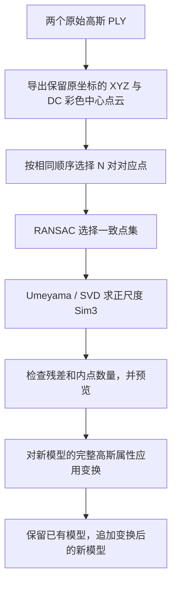

# 从 10 对控制点到完整 3DGS 拼接：Sim(3) 原理与代码实现

本文对应本项目当前的人工控制点工作流，解释三个问题：为什么少量对应点能对齐整个模型，Sim(3) 如何从这些点算出来，以及这个变换怎样正确地作用于完整高斯模型。

代码入口是 [多模型工作流](../src/gs_merger/pipeline.py)，数学实现主要在 [similarity.py](../src/gs_merger/similarity.py) 和 [gaussian_io.py](../src/gs_merger/gaussian_io.py)。操作命令见 [多模型使用说明](../README.md)。本文的实际数值来自一个已保存的十对地标案例。匿名化的坐标和期望矩阵包含在 [示例 JSON](../examples/ten_landmarks.json) 中，便于不依赖原始模型复算；它属于一次案例记录，不代表其他轮次必然有同样精度。

## 1. 为什么 10 对点可以对齐几百万个高斯

关键在于：**这 10 对点用来确定两个已有模型之间的坐标关系，而不是重新确定几百万个高斯各自的位置。**

每个子模型内部的相对位置、形状和外观，已经由 COLMAP 重建与 3DGS 训练利用大量图像信息估计出来。现在要解决的是：模型 B 的原点在哪里、坐标轴朝哪里、一个坐标单位相当于模型 A 的多少个单位。

如果两个模型描述同一个静态场景，并且各自的内部几何足够准确，它们之间可以近似只差一个统一的相似变换：

$$
\mathbf y=s\mathbf R\mathbf x+\mathbf t.
$$

这个变换只有 7 个自由度：

| 参数 | 含义 | 自由度 |
| --- | --- | ---: |
| $s>0$ | 统一尺度比例 | 1 |
| $\mathbf R\in SO(3)$ | 三维旋转 | 3 |
| $\mathbf t\in\mathbb R^3$ | 三维平移 | 3 |
| 合计 | 一个模型到另一个模型的坐标关系 | 7 |

旋转虽然写成一个 $3\times3$ 矩阵，但它的 9 个数不能任意变化：必须满足正交约束和正行列式，所以只有 3 个独立自由度。

每对三维对应点提供 3 个坐标等式。10 对点提供 30 个标量等式，用于约束同一组 7 自由度参数。在几何条件良好的情况下，这是一个有冗余约束的估计问题。

得到 $s,\mathbf R,\mathbf t$ 后，所有高斯中心都应用同一个公式。没有必要为每个高斯单独寻找一个对应点。

“30 个等式大于 7 个未知自由度”只是数量上的直觉，**点的空间分布和对应关系是否正确，同样决定能否求解、是否稳定**。10 个集中在一条直线附近的点，可能不如 4 个分布良好的点可靠。

## 2. 人工选点提供了什么信息，是否算“作弊”

点云配准通常包含两个不同问题：

1. **确定对应关系**：这个模型中的哪个位置，对应另一个模型中的哪个位置？
2. **估计变换参数**：已知若干对应关系后，求两个坐标系之间的旋转、平移和尺度。

人工选点主要解决第一个问题。例如，人能结合道路标线、路沿、立柱以及更大范围的上下文，判断两个局部模型中的某个转角是同一个物理位置。

自动配准需要从很多候选点中自己找到这些关系，还必须处理重复纹理、几何相似、尺度不同、低重叠和噪声。主要是平坦地面的场景，自动识别往往比参数求解困难得多。

当前方法可以准确描述为：**人工提供三维对应关系，程序进行鲁棒 Sim(3) 估计和完整高斯变换。** 在实际工程中，这是合理的人工辅助配准。COLMAP 的官方地理配准流程也使用已知三维位置之间的对应关系估计相似变换，并用 RANSAC 排除异常对应。[COLMAP 官方说明](https://colmap.github.io/faq.html#geo-registration)

如果研究目标是“全自动点云配准”，人工对应关系属于额外输入，不能把这个工作流的成功率直接当作自动方法的成功率。更公平的比较方式，是明确区分人工辅助结果和全自动结果，分别评价对应点生成与后续变换求解。

**gs-merger 使用人工对应关系，不调用任何自动描述子、匹配网络或 Pose 检查点。** 高斯读写与数学工具全部包含在本包中。人工选点后的拼接效果，不能作为自动配准方法能力的实验结论。

## 3. 当前工作流中，哪些数据参与了计算



### 3.1 查看点云只用于辨认和选点

`export_view_cloud()` 从高斯 PLY 中提取中心坐标，并用 DC 球谐系数生成查看颜色：

$$
\mathbf{RGB}_{view}=\operatorname{clip}
\left(0.5+C_0\mathbf f_{dc},0,1\right),
\qquad C_0=0.28209479177387814.
$$

这是标准 SH/DC 与 RGB 的换算关系；输出查看 PLY 时再量化为 8 位 RGB。[Graphdeco 官方 SH 工具](https://github.com/graphdeco-inria/gaussian-splatting/blob/main/utils/sh_utils.py)

查看点云不包含完整的椭球覆盖、透明度合成和视角相关颜色，因此它不等于真正的 3DGS 渲染。当前界面显示这些已有 RGB 值，没有额外做亮度或 Gamma 补偿。

默认查看导出保留所有通过有限性与 opacity 筛选的中心，也可以按配置抽样。这些操作影响可选点集合，不会把原模型中心化或换成另一个坐标系。对于当前标准 float32 高斯 PLY，导出点的 XYZ 就是相应中心的原坐标。

### 3.2 鼠标点击最后保存的是三维坐标

选点窗口先读取点击像素的深度，再反投影到三维空间，最后通过 KD-tree 吸附到查看点云中的最近中心。保存的是该中心的 XYZ，而不是屏幕像素坐标，也不是未经吸附的反投影结果。

求解器真正使用的是：

```text
source[i]：第 i 个物理地物在新模型坐标系中的 XYZ
target[i]：同一位置在已有模型坐标系中的 XYZ
```

`indices` 是查看点云中的索引。由于查看点云可能经过筛选或抽样，它不一定是原高斯 PLY 的行号；求解依赖保存的 XYZ，不依赖两个 PLY 的行号一致。

标记颜色、标记大小、编号标签和显示用的微小深度偏移不参与 Sim(3) 求解。

### 3.3 最终变换的是原始高斯 PLY

查看 PLY 只有 XYZ/RGB，不能替代高斯模型。最终合并重新读取原始高斯 PLY，对完整属性进行变换；不能把两个 RGB 查看点云相加后当作最终 3DGS。

## 4. Sim(3) 的方向、矩阵形式和一个小例子

两个子区域独立进行 COLMAP 重建、又没有共享控制点、已知基线等外部尺度约束时，
原点、坐标朝向和尺度可能不同。普通刚体变换 SE(3) 把尺度固定为 1，未必足够；
Sim(3) 增加一个统一尺度参数，但仍保持模型内部的角度和长度比例，不允许剪切或各轴独立拉伸。

全文约定：

- $\mathbf x$：source，新加入模型中的点。
- $\mathbf y$：target，已有累计模型坐标系中的点。
- $\mathbf R$：source 到 target 的纯旋转。
- $s$：source 到 target 的统一尺度。
- $\mathbf t$：用 target 坐标表示的平移。

“新模型移到已有模型中”写为：

$$
\mathbf y=s\mathbf R\mathbf x+\mathbf t,
\qquad
\mathbf T_{source\to target}=
\begin{bmatrix}
s\mathbf R&\mathbf t\\
\mathbf0^T&1
\end{bmatrix}.
$$

**矩阵左上角是 $s\mathbf R$，不一定是纯旋转矩阵。** 计算四元数前，必须先把尺度分离出来。

代码使用每行一个点的 NumPy 数组，因此批量应用时要转置左上角矩阵：

```python
aligned = source @ transform[:3, :3].T + transform[:3, 3]
```

这段是说明行向量约定的表达式，`source` 和 `transform` 分别表示已有点数组和矩阵。不能把它错误地写成 `source @ R`。

### 一个能直接验算的例子

假设已知三对点：

| source | target |
| --- | --- |
| $(0,0,0)$ | $(3,4,5)$ |
| $(1,0,0)$ | $(3,6,5)$ |
| $(0,1,0)$ | $(1,4,5)$ |

它们对应的变换是尺度放大 2 倍、绕 Z 轴旋转 90°，再平移 $(3,4,5)$：

$$
s=2,\qquad
\mathbf R=
\begin{bmatrix}
0&-1&0\\1&0&0\\0&0&1
\end{bmatrix},\qquad
\mathbf t=\begin{bmatrix}3\\4\\5\end{bmatrix}.
$$

例如，原来不参与求解的第四个点 $(0,0,1)$ 也会被同一个变换移到 $(3,4,7)$。对全部高斯的处理就是同样的过程，再同步处理椭球和方向颜色。

如果要反方向变换，不能只给平移取负数，应使用：

$$
\mathbf T^{-1}=
\begin{bmatrix}
\frac1s\mathbf R^T&-\frac1s\mathbf R^T\mathbf t\\
\mathbf0^T&1
\end{bmatrix}.
$$

## 5. 为什么至少要 3 对不共线点，地面上的点是否足够

只有 1 对点时，可以移动原点使这一对重合，但尺度和旋转都无法唯一确定。

有 2 对不同位置的点时，两点间距能约束尺度，连线方向能约束一部分旋转，但模型仍然可以绕这条连线转动。

第 3 个不在同一条直线上的对应点提供第二个独立方向。在理想一致的对应关系下，它与前两个点共同确定一个平面；两个面内方向及其叉积所确定的法向，能够约束一个保持右手系的三维旋转。

因此，在这里要求 $s>0$、$\det\mathbf R=+1$ 的前提下，**3 对正确、不共线、几何一致的三维对应点就可以确定 Sim(3)**。存在噪声时，程序求最小二乘近似，而不是要求三个边长比例完全一致。

共面和共线是不同的情况：

| 控制点分布 | 对当前问题的影响 |
| --- | --- |
| 分布在一个平面上，但不共线 | 可以求解；地面上的已知对应点可以使用 |
| 全在同一直线上 | 绕该直线的旋转无法唯一确定 |
| 非常接近一条直线 | 数值上可能不稳定，噪声影响较大 |
| 范围很小、集中在一个角落 | 局部拟合可能很好，但远处误差更容易放大 |

当前 `estimate_similarity()` 检查中心化点集的奇异值：第二大奇异值不能过小。它没有要求第三大奇异值也必须显著，因此不会把正常的地面控制点全部拒绝。

“只有一个无特征平面”的自动配准，和“平面上已经标明了对应位置”的配准也不同。前者可以沿平面滑动或转动而仍然贴合；后者的路沿转角、标线端点等对应位置，进一步固定了面内的平移、旋转和尺度。

## 6. Sim(3) 怎样通过 SVD 求出来

实现函数是 `gs_merger.similarity.estimate_similarity()`，对应带正旋转约束的 Umeyama 相似变换最小二乘估计。[Umeyama，1991，原论文](https://web.stanford.edu/class/cs273/refs/umeyama.pdf)

### 6.1 先写出要最小化的误差

给定 $N$ 对三维点 $\{\mathbf x_i,\mathbf y_i\}$，求：

$$
\min_{s>0,\ \mathbf R\in SO(3),\ \mathbf t}
\frac1N\sum_{i=1}^{N}
\left\|\mathbf y_i-(s\mathbf R\mathbf x_i+\mathbf t)\right\|^2.
$$

这是三维坐标空间中的误差，不是图像像素误差。当前实现对参与拟合的点等权，没有为每个点单独估计测量方差。

### 6.2 去掉平移：计算两组点的质心

$$
\bar{\mathbf x}=\frac1N\sum_i\mathbf x_i,
\qquad
\bar{\mathbf y}=\frac1N\sum_i\mathbf y_i.
$$

$$
\tilde{\mathbf x}_i=\mathbf x_i-\bar{\mathbf x},
\qquad
\tilde{\mathbf y}_i=\mathbf y_i-\bar{\mathbf y}.
$$

把两组点各自移到质心附近后，可以先估计旋转与尺度，再恢复平移。这里的中心化只发生在数学求解内部，不会重写保存的控制点或高斯模型。

### 6.3 构造相关矩阵

本文采用与代码一致的次序：

$$
\mathbf C=\frac1N\sum_i
\tilde{\mathbf y}_i\tilde{\mathbf x}_i^T.
$$

对应代码：

```text
covariance = centered_target.T @ centered_source / N
```

这个矩阵概括 source 与 target 的空间方向如何关联。注意这里是“target 乘 source 的转置”；交换次序后，旋转公式也必须相应调整。

### 6.4 用 SVD 求纯旋转，并排除镜像

对 $\mathbf C$ 做奇异值分解：

$$
\mathbf C=\mathbf U\mathbf\Lambda\mathbf V^T,
\qquad
\mathbf\Lambda=\operatorname{diag}(\sigma_1,\sigma_2,\sigma_3).
$$

构造修正矩阵：

$$
\mathbf D=\operatorname{diag}
\left(1,1,\det(\mathbf U\mathbf V^T)\right).
$$

最终旋转为：

$$
\boxed{\mathbf R=\mathbf U\mathbf D\mathbf V^T}.
$$

SVD 的轴方向可能组合出一个镜像关系。$\mathbf D$ 用来保证最终是合法旋转，而不是把整个场地翻成镜像。代码中的 `(u * sign) @ vt` 就是在给 $\mathbf U$ 的各列乘上 $\mathbf D$ 的对角元素。

### 6.5 求尺度

source 的平均平方离心距离为：

$$
v_x=\frac1N\sum_i\|\tilde{\mathbf x}_i\|^2.
$$

尺度解为：

$$
\boxed{s=\frac{\operatorname{tr}(\mathbf\Lambda\mathbf D)}{v_x}}.
$$

它同时利用多对点的空间关系，而不是用模型包围盒的大小比猜测尺度。两个子区域覆盖范围不同，包围盒比例通常不能代表重建尺度。

### 6.6 恢复平移

$$
\boxed{\mathbf t=\bar{\mathbf y}-s\mathbf R\bar{\mathbf x}}.
$$

至此，尺度、旋转和平移都得到，填入 $4\times4$ 矩阵即可。内部以 float64 计算，写回高斯属性时使用输入 PLY 的字段类型。

这一步只涉及点集统计和 $3\times3$ 矩阵的 SVD，计算量很小，不需要神经网络训练。

## 7. 为什么还需要 RANSAC，以及 10/10 内点是什么意思

即使人工辨认了同一处地物，也可能点到了不同边缘、相邻高斯中心，或者选错顺序。直接把所有点一起拟合，会让少数明显错误的对应点拉偏整个模型。

当前 `fit_control_points()` 使用 RANSAC 寻找一致点集，再对一致点重新拟合。RANSAC 的基本思想是从少量样本产生模型，再用其他数据检验支持程度。[Fischler 与 Bolles，1981，SRI 原始论文条目](https://www.sri.com/publication/artificial-intelligence-pubs/random-sample-consensus-a-paradigm-for-model-fitting-with-applications-to-image-analysis-and-automated-cartography-2/)

当前人工控制点路径的实际步骤是：

1. 检查两组点的形状、有限性和非共线性。
2. 随机抽取 3 对点，使用上一节的方法求一个候选 Sim(3)。
3. 计算所有对应点的残差 $e_i$。
4. 以 $e_i\le\tau$ 判断内点。
5. 优先选择内点数最多的候选；内点数相同，选择内点平均残差更小的候选。
6. 用当前内点重新求解，更新内点集合，最多进行 10 次这样的细化。
7. 最后重新计算变换、全部残差和内点标记。

残差定义为：

$$
e_i=\left\|s\mathbf R\mathbf x_i+\mathbf t-\mathbf y_i\right\|.
$$

当前函数默认随机种子为 `123`，最多抽样 `1000` 次；某个候选已使全部点都落入阈值时可以提前结束抽样，随后仍进行内点重拟合。它不是固定执行 1000 次，也不是穷举所有组合。

当前多模型默认设置为：

| 参数 | 默认值 | 含义 |
| --- | ---: | --- |
| `control_threshold` | `0.1` | 三维残差内点阈值，单位为参考模型坐标单位 |
| `min_inlier_ratio` | `0.8` | 完整点对中至少多大比例要成为内点 |
| 必需内点数 | $\max(3,\lceil0.8N\rceil)$ | 10 对点时为 8 对 |

日志中的 `10/10` 表示 **10 对控制点的三维残差都没有超过阈值**，不能解释成“整个场地的准确率是 100%”。阈值是异常点判定边界，不是测量精度声明。

本项目使用人工控制点函数 `fit_control_points()`，不包含自动特征配准或尺度区间搜索；估计的尺度必须为正且有限。

## 8. 用十对地标案例逐项解释

本节数值来自 [examples/ten_landmarks.json](../examples/ten_landmarks.json) 中的坐标和期望矩阵。

首先确认方向：**本案例把新模型 B 移到参考模型 A 的坐标系**。矩阵方向应以 source/target 定义和对应点顺序为准，不能仅凭目录名称判断。

### 8.1 实际变换矩阵

保留 8 位小数便于阅读：

```text
T_B_to_A =
[[ 0.04722093,  0.00935594, -0.39605769,  7.34088258],
 [ 0.00207275,  0.39884992,  0.00966902, -0.09123054],
 [ 0.39616276, -0.00320200,  0.04715781, -0.37836160],
 [ 0.00000000,  0.00000000,  0.00000000,  1.00000000]]
```

实际处理应继续读取保存的 `.npy` 矩阵，避免手抄和重复舍入。

分解后：

$$
s=0.39897248417253484,
\qquad
\mathbf t\approx
\begin{bmatrix}
7.34088258\\-0.09123054\\-0.37836160
\end{bmatrix}.
$$

这表示 source 中长度为 1 的线段，变换后在 reference 坐标中长度约为 0.399。它不表示道路在现实中变小了，而是在换算两个独立重建的坐标单位。

把矩阵左上角除以 $s$ 才得到 $\mathbf R$。本次计算的 $\det\mathbf R$ 约为 `0.9999999999999996`，浮点误差范围内等于 1。

### 8.2 一对点的实际计算

第 1 对点为：

```text
source = [-2.11588979, 0.12314795, 10.43367577]
target = [ 3.11093998, 0.05356859, -0.71950930]

T(source) = [3.10978295, 0.05438476, -0.72496331]
```

`T(source)` 与 target 不完全相同，两者的三维距离约为 `0.00563480`。最终矩阵综合拟合多对点，而不是强制某一对绝对重合，所以这种非零残差是正常的。

### 8.3 本次 10 对点的残差

| 点对编号 | 三维残差，参考坐标单位 |
| ---: | ---: |
| 1 | 0.00563480 |
| 2 | 0.00579869 |
| 3 | 0.00295838 |
| 4 | 0.00901184 |
| 5 | 0.00262279 |
| 6 | 0.00230749 |
| 7 | 0.00511307 |
| 8 | 0.00431049 |
| 9 | 0.00478336 |
| 10 | 0.00310470 |

由全部 10 对点复算：

| 统计量 | 数值 |
| --- | ---: |
| 平均残差 | 0.00456456 |
| RMSE，即 $\sqrt{\frac1N\sum_i e_i^2}$ | 0.00494761 |
| 最大残差 | 0.00901184 |
| 内点阈值 | 0.1 |
| 内点数 / 要求内点数 | 10 / 8 |

这些数值表明，本次选取位置能被同一个 Sim(3) 较好解释。**在没有参考模型单位到米的换算关系前，不能把 `0.00494761` 称为毫米级或厘米级误差。**

这 10 个 target 点中心化后的三个奇异值约为 `0.79118、0.27956、0.00592`。第三个很小，说明点集接近一个平面；第二个仍然明显非零，说明它不是一条直线。这与地面场景的可解条件一致。

但本次控制点包围盒对角线约为 `0.73906` 个参考单位。这只描述选点覆盖范围，不是整个场地范围。控制点范围之外的精度，还需要独立检查。

## 9. 高斯模型为什么不能只变换 XYZ

普通彩色点可以近似看作“位置 + RGB”。一个 3DGS 高斯还具有空间范围、方向、透明度与随视角变化的颜色。

当前标准 Graphdeco PLY 中，主要字段的含义如下。激活方式和 PLY 序列化方式可核对 [Graphdeco 官方 GaussianModel](https://github.com/graphdeco-inria/gaussian-splatting/blob/main/scene/gaussian_model.py)。

| PLY 字段 | 含义 | 当前变换方式 |
| --- | --- | --- |
| `x, y, z` | 高斯中心 $\boldsymbol\mu$ | $s\mathbf R\boldsymbol\mu+\mathbf t$ |
| `scale_0..2` | 三个轴向标准差的自然对数 $\ell_k$ | $\ell_k+\ln s$ |
| `rot_0..3` | 高斯自身的 wxyz 四元数 $q$ | 左乘全局旋转四元数并归一化 |
| `f_dc_0..2` | RGB 三通道的零阶 SH 系数 | 保持 |
| `f_rest_*` | 更高阶的 RGB 方向颜色系数 | 按 SH 阶数旋转 |
| `opacity` | 透明度的 logit，激活后为 sigmoid | 保持 |
| `nx, ny, nz`，如果存在 | 法线 | 乘纯旋转 $\mathbf R$ |
| 其他标量字段 | 额外属性 | 原值复制 |

如果只改 XYZ，中心虽然对齐，但椭球仍可能保持旧方向和旧大小，视角相关颜色也仍按旧坐标方向解释。因此这不等价于把完整高斯模型移动到新坐标系。

## 10. 高斯中心、协方差、尺度和四元数如何变换

### 10.1 用协方差表示一个高斯椭球

设一个高斯的中心是 $\boldsymbol\mu$，自身方向矩阵是 $\mathbf Q$，三个轴向标准差是 $a_1,a_2,a_3$。其协方差可写为：

$$
\mathbf\Sigma=\mathbf Q
\operatorname{diag}(a_1^2,a_2^2,a_3^2)\mathbf Q^T.
$$

PLY 中保存的是 $\ell_k=\ln a_k$，不是 $a_k$，也不是方差 $a_k^2$。

高斯空间形状中的指数项可写为：

$$
G(\mathbf p)=\exp\left[-\frac12
(\mathbf p-\boldsymbol\mu)^T\mathbf\Sigma^{-1}
(\mathbf p-\boldsymbol\mu)\right].
$$

### 10.2 中心与协方差的正确公式

令线性部分 $\mathbf A=s\mathbf R$，则：

$$
\boxed{\boldsymbol\mu'=s\mathbf R\boldsymbol\mu+\mathbf t}
$$

$$
\boxed{\mathbf\Sigma'=\mathbf A\mathbf\Sigma\mathbf A^T
=s^2\mathbf R\mathbf\Sigma\mathbf R^T}.
$$

平移只改变中心，不改变椭球形状。旋转改变椭球轴的方向，统一尺度改变三个轴的长度，而协方差中的量是长度平方，因此出现 $s^2$。

这一公式也保证，对相应变换后的空间点 $\mathbf p'=s\mathbf R\mathbf p+\mathbf t$，有：

$$
(\mathbf p'-\boldsymbol\mu')^T\mathbf\Sigma'^{-1}
(\mathbf p'-\boldsymbol\mu')
=
(\mathbf p-\boldsymbol\mu)^T\mathbf\Sigma^{-1}
(\mathbf p-\boldsymbol\mu).
$$

也就是说，高斯的空间形状随坐标变换一致地移动和缩放。

### 10.3 为什么对数尺度要“加 log(s)”

由于 $a'_k=s a_k$：

$$
\boxed{\ell'_k=\ln a'_k=\ln a_k+\ln s}.
$$

不是把 `scale_0..2` 直接乘以 $s$。

本次 $s\approx0.39897248$，因此三个对数尺度都加上：

$$
\ln s\approx-0.91886283.
$$

轴长变为原来的约 0.399 倍，协方差的整体尺度因子则是 $s^2\approx0.15917904$。三个轴长之间的比例保持不变，不会把原来的细长椭球强行变成球体。

### 10.4 为什么四元数要左乘

原高斯自身方向是 $\mathbf Q$，整个模型的旋转是 $\mathbf R$，所以新方向为：

$$
\mathbf Q'=\mathbf R\mathbf Q.
$$

按代码使用的 wxyz 四元数约定，对应：

$$
\boxed{q'=q_R\otimes q}.
$$

`quaternion_left_multiply()` 实现这个顺序。四元数乘法通常不可交换，写成 $q\otimes q_R$ 一般会得到不同的方向。

程序先归一化输入四元数，用纯旋转 $\mathbf R$ 生成 $q_R$，相乘后再归一化。不能直接把含尺度的 $s\mathbf R$ 当旋转矩阵转成四元数。

### 10.5 opacity 和法线怎么处理

当前实现保留 `opacity` 的原始 logit。这里的 opacity 是高斯 splatting 合成参数，不是“归一化概率密度的质量”；不要因为协方差变大或变小，就额外乘上 $s^3$ 或 $1/s^3$。

若存在法线，代码使用 $\mathbf n'=\mathbf R\mathbf n$。对于当前正的统一尺度，单位法线方向只需要纯旋转；输入为零法线时，仍保持零。

这些规则针对当前支持的正尺度 Sim(3)。对于剪切、非均匀尺度或镜像，不能不加判断地沿用同一套参数更新方式；`split_similarity()` 会拒绝这些矩阵。

## 11. 球谐颜色为什么也需要旋转

### 11.1 高斯颜色不一定是一个固定 RGB

先只看某一个颜色通道的 SH 部分，它随单位观察方向 $\mathbf d$ 变化，可写为：

$$
f(\mathbf d)=\sum_{l=0}^{L}\sum_{m=-l}^{l}
c_{lm}Y_{lm}(\mathbf d).
$$

最终颜色还涉及固定的 `+0.5` 偏置与渲染器的颜色处理；它们不改变下面的方向旋转关系。
RGB 三个通道各有一组系数。零阶是与方向无关的常数，更高阶用于表示随方向变化的外观。

以三阶 SH 为例，每通道有 $(3+1)^2=16$ 个系数；其中 1 个是 DC，15 个是更高阶。RGB 合起来是 3 个 DC 系数和 45 个 `f_rest_*` 系数。

### 11.2 模型旋转后，方向也换了坐标表达

整个模型旋转后，同一个物理观察方向在新坐标系中写作 $\mathbf d'=\mathbf R\mathbf d$。要保留相应的方向外观，需要：

$$
\boxed{f'(\mathbf d')=f(\mathbf R^T\mathbf d')}.
$$

如果只旋转椭球和中心，却保持所有高阶 SH 数字不变，就相当于把它的方向外观留在旧坐标方向上。

这里“旋转颜色系数”是在改变方向函数的坐标表达，不是在做曝光、亮度、对比度或颜色风格调整。**DC 保持不变，高阶系数的数值可能改变，目的是使相应观察方向的颜色保持一致。**

### 11.3 当前代码如何得到 SH 旋转块

`sh_rotation_blocks()` 按每一阶分别构造旋转矩阵。第 $l$ 阶的矩阵大小为 $(2l+1)\times(2l+1)$；三阶模型分别需要 $3\times3$、$5\times5$、$7\times7$ 三个块。

在单位球面选取 128 个方向样本，构造 SH 基函数矩阵，并解：

$$
\mathbf Y_l(\mathbf d)\mathbf D_l
=\mathbf Y_l(\mathbf R^T\mathbf d).
$$

右侧在代码的行向量写法中对应 `directions @ rotation`。对一列系数有：

$$
\mathbf c'_l=\mathbf D_l\mathbf c_l.
$$

系数在 NumPy 中按行存储，因此实际批量乘的是 `block.T`。

同一阶 SH 在旋转下仍处于该阶函数空间中，所以这里用过定约束最小二乘得到旋转块，不是靠 128 个方向重新学习场景颜色。实现使用 float64，仍会有浮点舍入误差。

标准 PLY 中的 `f_rest_*` 按颜色通道排列，程序先整理成“高斯数 × 3 通道 × 非 DC 基函数数”，再逐阶旋转。SH 的基函数次序和符号必须与模型一致；本项目的 `real_sh_basis()` 按标准 Graphdeco 约定实现，并有方向颜色一致性测试。

## 12. 多个模型为什么能按顺序一直拼

设第一个模型的坐标系为固定参考系 $\mathcal F_1$。

```text
第 1 轮：model2 → model1，得到 M2
第 2 轮：model3 → M2，得到 M3
第 3 轮：model4 → M3，得到 M4
```

$M_2,M_3,M_4$ 中的点始终都已经使用 $\mathcal F_1$ 坐标。每轮对新模型求的是直接进入该固定参考系的变换：

$$
\mathbf T_{2\to1},\qquad
\mathbf T_{3\to1},\qquad
\mathbf T_{4\to1}.
$$

例如，第 2 轮即使选择的是原来属于 model2 的地物，这些点在累计模型中也已经变成参考系 $\mathcal F_1$ 的坐标，所以这次求出的矩阵已经是 $\mathbf T_{3\to1}$。

**不要再把它额外乘一次 $\mathbf T_{2\to1}$。** 如果另一套算法是在两个原始局部模型之间估计 $\mathbf T_{3\to2}$，才需要做 $\mathbf T_{3\to1}=\mathbf T_{2\to1}\mathbf T_{3\to2}$ 这样的链式组合；这不是当前累计目标的输入方式。

已有模型在每轮中只复制，不反复重新旋转、缩放。每个新加入模型的完整属性变换后追加到已有模型后面：

$$
\mathcal G_{new}=\mathcal G_{accumulated}\mathbin{\Vert}
\operatorname{Transform}(\mathcal G_{incoming},\mathbf T).
$$

这里的 $\Vert$ 表示记录追加，不是重复高斯融合。当前多模型后端以 `minimum_opacity=0` 保留所有高斯，因此最终数量是各输入高斯数量之和。

固定第一个参考系能避免把已合并数据反复变换，但不能消除估计误差的传播。如果后续轮次依赖的累计区域本身已有偏差，这些偏差仍会影响下一次选点和求解。当前流程没有做全局位姿图或闭环优化。

## 13. 如何理解“看起来很准”和真正的精度

### 13.1 控制点残差属于参与拟合的数据误差

这 10 对点已经参与参数估计，在它们上面计算的小残差，说明模型能解释这些约束；它不等于在所有其他位置都验证过。

更有说服力的做法是另外选择一组**不参与拟合**的检查点，计算：

$$
e_j^{check}
=\left\|s\mathbf R\mathbf x_j^{check}+\mathbf t
-\mathbf y_j^{check}\right\|.
$$

检查点应覆盖较大的重叠范围，并尽量包含控制点之外的地物。可以分别报告均值、RMSE、最大值及误差随位置的变化；当前脚本不会自动生成独立检查点报告。

### 13.2 点分布范围会影响远处误差

以控制点中心附近为基准，设相对尺度误差为 $\varepsilon$、小旋转误差大小为 $\delta\theta$，考虑距该中心约 $r$ 的位置，则误差量级可理解为：

$$
\|\delta\mathbf p\|\lesssim
\|\delta\mathbf t_c\|+r|\varepsilon|+r|\delta\theta|.
$$

角度在公式中使用弧度。这是小误差下的量级解释，不是本程序给出的误差上界或置信区间。

举一个已知米制单位的假设例子：如果旋转偏差为 $0.1^\circ$，在距离控制点中心 100 米处，仅这一项就可带来约 $100\times0.1\pi/180\approx0.175$ 米的位置误差。因此，同一块小标线附近拟合得很好，不足以证明整个大场地都精确。

### 13.3 更多点什么时候有用

更多、分布更广、辨认更可靠的控制点通常有助于平均随机点击误差、发现错配和约束整个重叠范围。但大量集中在同一处的点不一定增加多少有效几何信息。

在随机误差独立、无系统偏差、几何分布相近的理想条件下，平移误差常有约 $1/\sqrt N$ 的改善趋势，角度与相对尺度的误差还与控制点的空间跨度有关。这不是无条件精度保证：同一处边缘的系统性偏移、重复地物误认、模型局部形变都不会因为点数增加而自动消失。

对当前主要是地面的场地，选点时应优先考虑：

- 同一个物理位置，避免一侧选标线内沿、另一侧选外沿。
- 覆盖重叠区的不同方向和较大范围，避免全部沿一条路沿排列。
- 有条件时包含不同高度或不同类型地物，用来检验整体几何一致性。
- 不把所有可见地物都用作控制点，留一些作为独立检查。

### 13.4 哪些误差不是 Sim(3) 能修复的

| 情况 | 一个全局 Sim(3) 能否直接处理 |
| --- | --- |
| 两模型原点、坐标轴、统一尺度不同 | 正是它处理的问题 |
| 一个区域发生局部弯曲或尺度漂移 | 不能用单一全局 Sim(3) 完全修复 |
| 独立训练的 floaters、表面厚度不同 | 不能保证只靠坐标变换消除 |
| 两次采集中有车辆或其他动态物体变化 | 不会把动态物体自动变成一致 |
| 两个模型曝光或颜色基准不同 | 当前不做曝光统一 |
| 重叠区有两套高斯 | 当前保留两套，可能产生接缝或重影 |
| 完全没有共同地物，也没有外部坐标约束 | 无法从输入本身唯一推断拼接关系 |

高斯中心不一定是经过测量的精确表面采样点；两次独立训练也未必在同一表面位置产生完全相同的中心。视觉效果好、控制点残差小和测量级几何准确，是需要分别验证的事情。

## 14. 当前代码实际做到了哪一步

| 代码位置 | 主要职责 |
| --- | --- |
| `point_picker.py` 中的 `OrderedPoints`、`PointPicker.mouse()` | 保留选点顺序，深度拾取后吸附到查看中心，保存 XYZ |
| `interaction.py` 中的 `select_pair()` | 双窗口协调、重选与完整点对确认 |
| `similarity.py` 中的 `estimate_similarity()` | 已知对应关系的正尺度 SVD 最小二乘求解 |
| `similarity.py` 中的 `fit_control_points()` | 控制点 RANSAC、内点重拟合与残差 |
| `pipeline.py` 中的 `save_alignment()` | 内点门槛判断，保存矩阵和报告 |
| `gaussian_io.py` 中的 `split_similarity()` | 检查并分解合法的 $s,\mathbf R,\mathbf t$ |
| `gaussian_io.py` 中的 `transform_gaussians()` | 更新中心、四元数、对数尺度、法线与高阶 SH |
| `gaussian_io.py` 中的 `merge_gaussian_files()` | 本项目内置的标准 PLY 分块高斯合并后端 |
| `gs_merger/io_utils.py` | 在临时目录执行合并，成功后提交完整结果 |
| `gs_merger/merge_worker.py` | 在独立计算进程执行，转发进度与停顿诊断 |
| `pipeline.py` 中的 `publish_final()` | 返回最终模型真实路径，记录每个原始模型到参考系的矩阵 |

多模型流程可以稳定执行的前提，仍然是每轮有足够可靠的几何约束。独立进程、分块、磁盘映射和检查点属于执行与恢复机制，不会增加新的场景约束，也不会使不正确的对应关系变正确。

当前流程没有隐含的 ICP 精配准、全局位姿优化或联合 3DGS 再训练。控制点拟合与人工预览通过后，就应用该 Sim(3) 并追加高斯记录。

结果文件提供了这条计算链的检查入口：

| 文件 | 可以检查的内容 |
| --- | --- |
| 每轮 `selections.json` | 完整确认的对应点、查看点索引及显示尺寸 |
| 每轮 `correspondences.json` | 用于求解的 source/target XYZ、模型路径和方向 |
| 每轮 `alignment.json` | 尺度、矩阵、每对点残差、内点掩码和是否通过门槛 |
| 每轮 `transform_source_to_target.npy` | 应用于原始高斯的完整精度矩阵 |
| 每轮 `step.json` | 已提交模型的数量、文件签名与本轮变换 |
| `final.json` | 最后一轮 `merged.ply` 的真实路径，以及每个原始模型到固定参考系的变换清单 |

如果之后需要用原始图像继续训练，还需要同步处理相机参数。以相机中心 $\mathbf C$ 和相机到世界的方向矩阵 $\mathbf U$ 为例，应有 $\mathbf C'=s\mathbf R\mathbf C+\mathbf t$、$\mathbf U'=\mathbf R\mathbf U$。当前脚本只处理 PLY，不会自动改写 COLMAP 相机、训练检查点或优化器状态。

## 15. 如何自己复算本次矩阵和误差

安装本项目后，在项目根目录执行：

```bash
python examples/verify_sim3.py
```

这个脚本读取已包含的匿名地标 JSON，重算矩阵并与期望结果比较，无需原始 PLY，
不会打开 GUI，也不写模型。等价的核心代码为：

```python
import json
from pathlib import Path
import numpy as np
from gs_merger.gaussian_io import split_similarity
from gs_merger.similarity import fit_control_points

example = json.loads(Path("examples/ten_landmarks.json").read_text())
transform, mask, residuals = fit_control_points(
    example["source"], example["target"],
    threshold=example["control_threshold"], seed=example["seed"],
)
scale, rotation, translation = split_similarity(transform)

print("与保存的矩阵一致:", np.allclose(transform, example["expected_transform"]))
print("scale:", scale)
print("rotation:\n", rotation)
print("translation:", translation)
print("inliers:", int(mask.sum()), "/", len(mask))
print("RMSE:", np.sqrt(np.mean(residuals**2)))
print("max residual:", residuals.max())
```

复算自己的输出时，读取相应 `steps/NNN/correspondences.json` 的 `source`、`target`，
使用 `alignment.json` 的 `control_threshold` 和会话种子，再与保存的矩阵对照。
比较不同次试验时，应同时核对控制点、阈值、参考坐标系和变换方向；仅比较一个残差数字不足以判断哪次拼接更可靠。

### 可继续阅读的原始资料

- [Umeyama：Least-Squares Estimation of Transformation Parameters Between Two Point Patterns，1991](https://web.stanford.edu/class/cs273/refs/umeyama.pdf)：相似变换的最小二乘闭式解。
- [Fischler 与 Bolles：Random Sample Consensus，1981](https://www.sri.com/publication/artificial-intelligence-pubs/random-sample-consensus-a-paradigm-for-model-fitting-with-applications-to-image-analysis-and-automated-cartography-2/)：从少量样本提出模型、用一致性进行鲁棒估计。
- [3D Gaussian Splatting 原作者项目页](https://repo-sam.inria.fr/fungraph/3d-gaussian-splatting/)：高斯表示、训练和渲染背景。
- [Graphdeco `gaussian_model.py`](https://github.com/graphdeco-inria/gaussian-splatting/blob/main/scene/gaussian_model.py)：标准属性激活、协方差构造与 PLY 布局。
- [Graphdeco `sh_utils.py`](https://github.com/graphdeco-inria/gaussian-splatting/blob/main/utils/sh_utils.py)：SH 基函数约定与 DC/RGB 换算。
- [COLMAP Geo-registration](https://colmap.github.io/faq.html#geo-registration)：利用已知三维位置对应关系估计相似变换的工程实例。
